# Análise da Arquitetura Monolítica — ToggleMaster

## Caracteristicas da aplicação

O **ToggleMaster** é uma API desenvolvida em Python, utilizando o framework Flask, que tem como objetivo gerenciar Feature Flags, da qual permite ativar ou desativar funcionalidades de um sistema sem a necessidade de realizar novos deploys.

A aplicação possui uma **arquitetura monolítica**, pois suas funcionalidades de negócio estão concentradas em uma única aplicação, sendo executadas e implantadas como uma única unidade.

## Justificativa da arquitetura monolítica

Ao analisar o arquivo **app.py,** identificamos que as funcionalidades de criação, consulta, listagem e atualização de features flags, estão todas concentradas no mesmo código, compartilhando a mesma lógica de conexão com o banco de dados PostgreSQL o que se caracteriza numa arquitetura monolítica.

Abaixo percebemos que a aplicação disponibiliza os seguintes endpoints:

- POST /flags: Criação de uma nova Feature Flag.

- GET /flags: Listagem das flags cadastradas.

- GET /flags/\<name\>: Consulta de uma flag específica.

- PUT /flags/\<name\>: Atualização do estado de uma flag.

- GET /health — Verificação da disponibilidade da aplicação.

Foi utilizado também o Docker Compose para definir e gerenciar os contêineres da aplicação Flask e do Banco de dados por meio de um único arquivo de configuração. Essa ferramenta também possibilita configurar variáveis de ambientes, redes, volumes e dependências entre os serviços.

Uma observação importante é que apesar de a aplicação e o banco de dados serem executados em contêineres separados, essa organização não caracteriza uma arquitetura de microsserviços, pois as funcionalidades de negócio permanecem concentradas em um único serviço, sem divisão em componentes independentes de implantação. Por isso essa API é considerada monolítica devido a centralização das funcionalidades.

### Vantagens:

- Fácil desenvolvimento fácil implantação.

- Facilidade de manutenção em aplicações de pequeno porte.

- Menor complexidade de comunicação entre funcionalidades.

### Desvantagens:

- Dificuldade de escalar funcionalidades individualmente.

- Maior acoplamento entre os componentes da aplicação.

- Alterações no código podem exigir a implantação de toda a aplicação dificultando o processo.

Nesse caso, concluímos que o ToggleMaster apresenta uma arquitetura monolítica devido à centralização de suas funcionalidades em uma única aplicação Flask.

Essa abordagem é adequada para a fase inicial do projeto (MVP), pois facilita o desenvolvimento e a implantação. No entanto, conforme a aplicação vai crescendo, podem surgir desafios ou problemas relacionados à escalabilidade, manutenção e evolução do sistema. Em cenários como em larga escala a opção de microsserviços pode ser considerada como alternativa para não prejudicar seu desempenho conforme as necessidades de cada projeto.

## RELAÇÃO DO PROJETO COM OS 12 FATORES

A relação do projeto com os 12 fatores atende parcialmente devido aos principais requisitos conforme classificado no link: <https://12factor.net/pt_br/>.

### BASE DE CÓDIGO

Não atende aos requisitos pois o README menciona o Git, mas os arquivos não comprovam que existe um repositório versionado com múltiplos deploys.

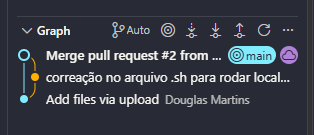

### DEPENDENCIAS

Atende aos requisitos, pois em requirements.txt, é declarado explicitamente as dependências isolando-as de um ambiente externo. Pelo que foi percebido no projeto é feito de duas formas pelo requirements.txt e o dockerfile utiliza uma imagem para criar um ambiente de excução da aplicação instalando suas dependências dentro do contêiner.

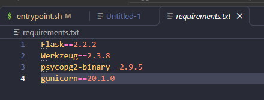  

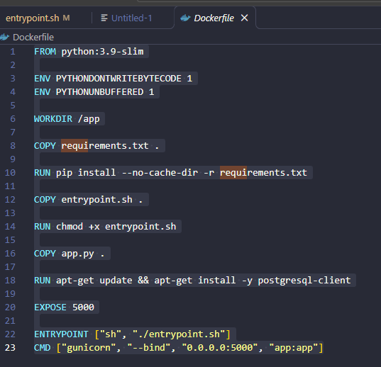  

### CONFIGURAÇÕES  
Atende parcialmente pois as configurações de acesso ao banco utilizam variáveis ambiente, mas existem credenciais fixas no Docker Compose.

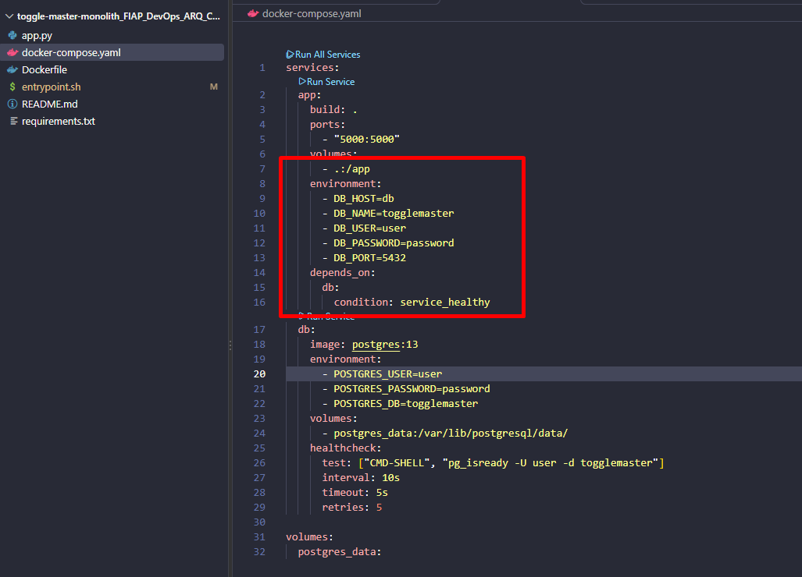

### SERVIÇOS DE APOIO

Atende, pois o Banco de dados é utilizado como serviço externo à aplicação Flask, acessado por parâmetros de conexão.

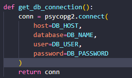

### BUILD RELEASE E RUN

Atende parcialmente, no dockerfile é separado a construção da imagem da execução, mas não há um processo completo de releases versionadas.

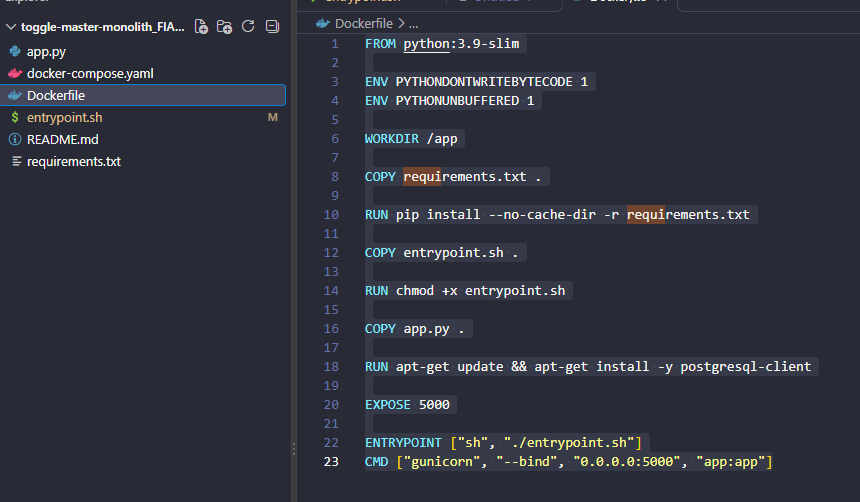

### PROCESSOS

Atende, pois a aplicação não depende de uma variável na memória do processo, logo, as flags são diretamente armazenadas no PostgreSQL.

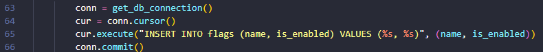

### VINCULO DE PORTA

Atende pois o gunicorn disponibiliza a API pela porta 5000, utilizando 0.0.0.0.

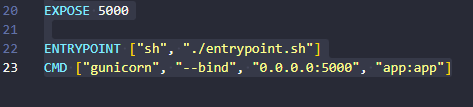

### CONCORRENCIA

Parcialmente, pois o gunicorn permite múltiplos workers, mas o projeto não configura escalabilidade horizontal.

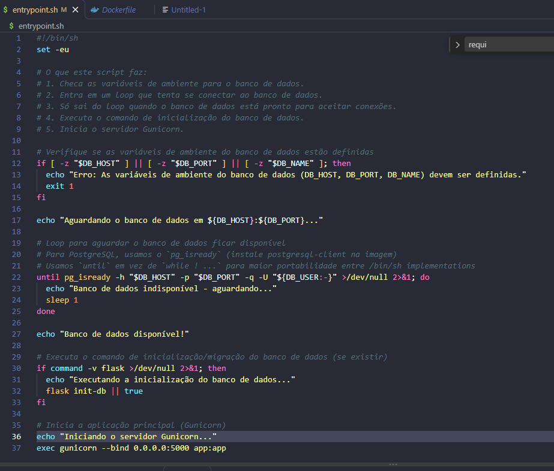

### DESCARTABILIDADE

Parcialmente, pois existe controle de inicialização, mas faltam verificações mais robustas e limites de espera na inicialização.

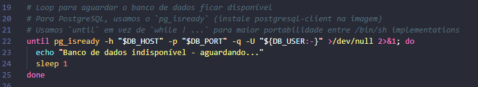

### PARIDADE DEV/PROD

Parcialmente, pois no desenvolvimento utiliza Docker e PostgreSQL local, enquanto o deploy AWS descrito utiliza EC2 com Python instalado manualmente e RDS.

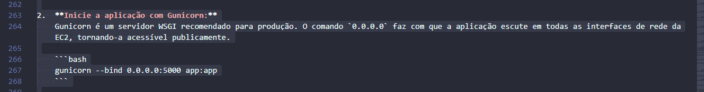

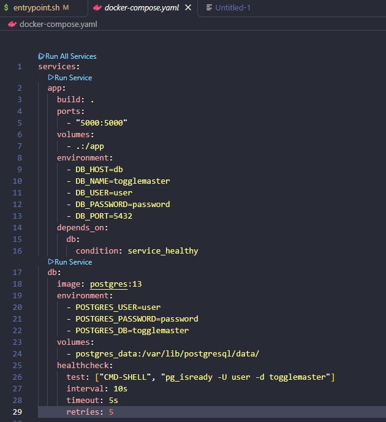

### LOGS

Parcialmente, pois a aplicação escreve mensagens na saída padrão, mas não possui uma estratégia documentada de coleta e centralização.

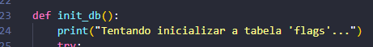

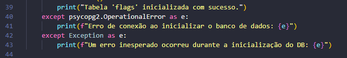

### PROCESSOS ADMINISTRATIVOS

Parcialmente pois no comando flask init-db, mas ele é chamado durante a inicialização normal da aplicação.

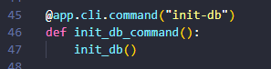

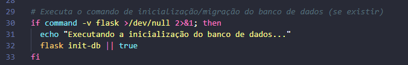  

## CONCLUSÃO

Diante das análises pudemos analisar que o projeto é de fato uma aplicação monolítica e não se enquadra dentro dos 12 fatores devido as evidências apresentadas acima.

## PRINCIPAIS DESAFIOS

Tivemos desafios para conseguir entender e interpretar o projeto e alguns erros no código de inicio para rodar a aplicação no VS code tendo que ajustar o CRLF. Identificamos que a API não possui uma autenticação de segurança, existe falhas para inicializar o banco que são ignoradas e credenciais expostas na configuração. A porta do banco parece estar configurada, mas não é utilizada
